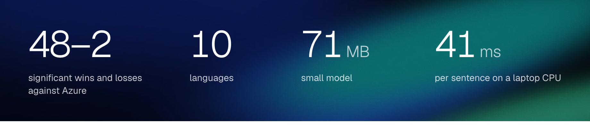
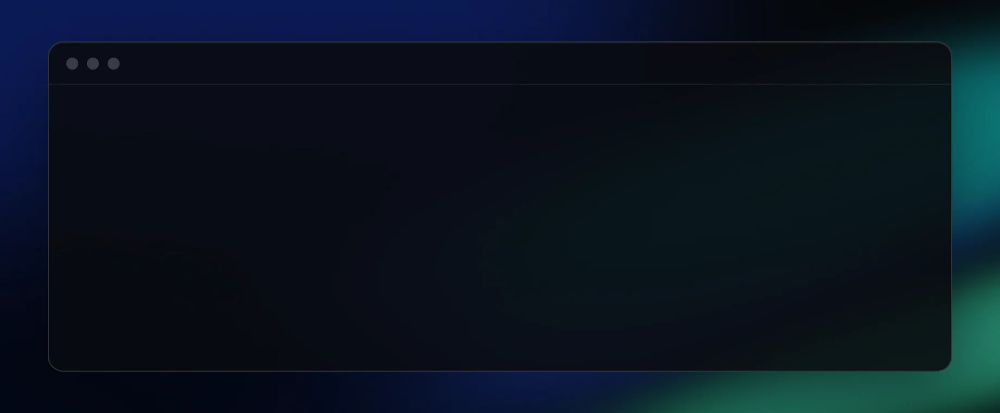
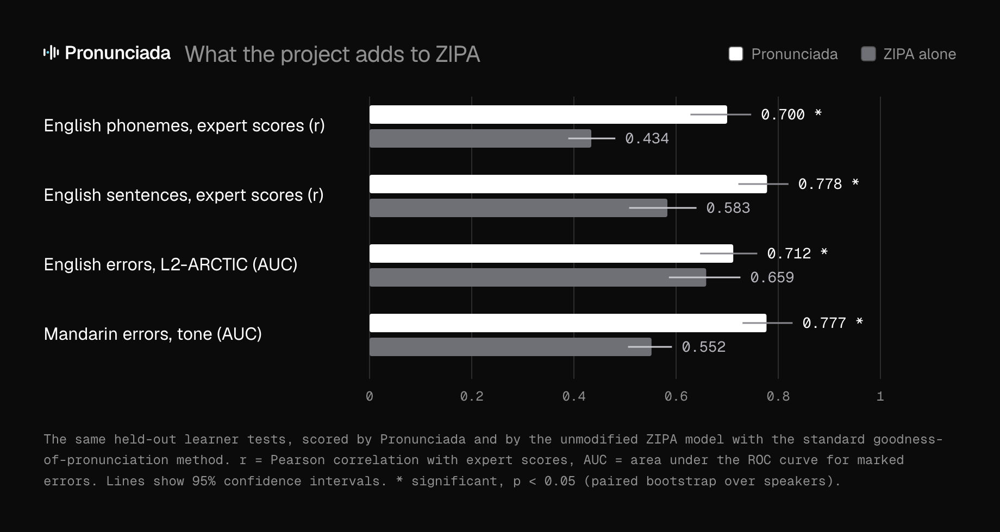
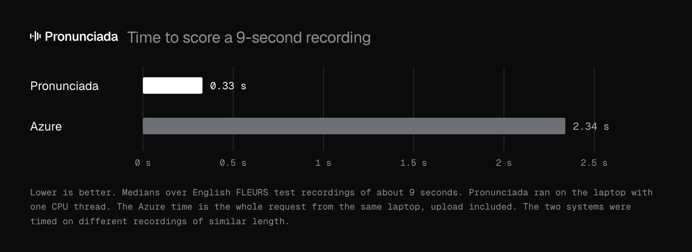
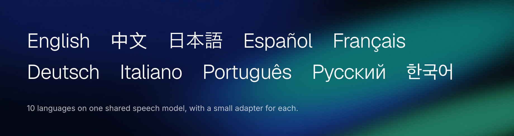

<p align="center">
  
</p>

<h1 align="center">Pronunciada</h1>

<p align="center">
  On-device pronunciation assessment with cloud-level accuracy.<br>
  Open source · 10 languages · 71 MB
</p>

<p align="center">
  <a href="https://pypi.org/project/pronunciada/"></a>
  <a href="https://pypi.org/project/pronunciada/"></a>
  <a href="https://github.com/moglearn/pronunciada/actions/workflows/ci.yml"></a>
  <a href="LICENSE"></a>
</p>

<p align="center">
  <a href="https://pronunciada.dev">Website</a> ·
  <a href="#quick-start">Quick start</a> ·
  <a href="#benchmarks">Benchmarks</a> ·
  <a href="#how-it-works">How it works</a> ·
  <a href="https://pypi.org/project/pronunciada/">PyPI</a> ·
  <a href="https://huggingface.co/kimitonatsu/pronunciada">Hugging Face</a>
</p>

Pronunciada scores a language learner's pronunciation sound by sound, in 10 languages, on the learner's own device. It is open source, and it is the [state of the art for on-device pronunciation assessment](https://pronunciada.dev/benchmarks/). Against Microsoft Azure's cloud service it comes out ahead in all 10 languages: across 84 public tests it is significantly better on 48 and worse on 2.

It needs no GPU and no network. A sentence is scored in about 40 ms on a laptop CPU with a 71 MB model, and the audio never leaves the machine.

**[Benchmarks on real learner speech →](https://pronunciada.dev/benchmarks/)** Pronunciada against Azure, OpenPronounce, Lingolix, TonePerfect and Chivox on the same recordings.



https://github.com/user-attachments/assets/b8641ae2-621a-49da-9b09-d404ec9887eb

## Quick start

```bash
pip install pronunciada
pronunciada check clip.wav "It was a beautiful day for a float" --lang en
```



<details>
<summary>Output as text</summary>

```text
~ Close  sentence 75% · accuracy 7.6/10 · fluency 8.5/10   en · strictness 0.5

  It was a beautiful day for a float
           ~~~~~~~~~         ~ ^^^^^

  beautiful  63%  b 92%  [j→b 67%]  u 66%  t 58%  [ə 57%]  f 84%  ə 64%
                  [l̴ 65%]
  a          79%  [ɪ 64%]
  float      10%  f 83%  [l 27%]  [oʊ 35%]  t 56%

  → Let the air pass along the sides of the tongue for /l/ in “float”.
```

</details>

The recording is a learner from the speechocean762 test set ([`en-learner-1.mp3`](site/samples/en-learner-1.mp3)). The corpus annotators marked the /l/ of "float" as dropped, and Pronunciada gives that word 0.10.

The same call from Python:

```python
import pronunciada

result = pronunciada.score("clip.wav", "It was a beautiful day for a float", lang="en")

result.prob                # 0.75, the sentence
result.words[7].prob       # 0.10, the word "float"
result.words[7].phones     # f 0.83, l 0.27, oʊ 0.35, t 0.56
result.coaching()          # the detected errors, most severe first
```

You give it a recording and the text the speaker was reading. It returns the probability, from 0 to 1, that a human rater would accept each sound, each word and the sentence. The model is downloaded on first use.

## Benchmarks

Most language-learning apps buy their pronunciation scores from a cloud service, and the most widely used one is Microsoft Azure Pronunciation Assessment. Pronunciada was compared with it on 84 public tests, with the same recordings and text given to both.


Pronunciada is significantly better on 48 of the tests and Azure on 2. The other 34 show no significant difference. In each of the 10 languages Pronunciada wins more tests than it loses. Azure's two wins are both in English: it marks a native speaker's words down a little less often, and it is better at telling native from non-native speakers in one test on Common Voice recordings.

One test covers all 10 languages in the same way. A native recording is scored against a text in which one word was replaced by a word one sound away, and the system has to notice the mismatch. It is not a test on learner speech.


The most direct tests use recordings of learners that experts have graded by hand, which are public for English and Mandarin. Pronunciada agrees with the experts more closely than Azure on individual sounds, on words and on sentence accuracy. On English intonation the two are level.


It is also better at finding the sounds and the Mandarin tones that teachers marked as wrong.

Pronunciada is built on [ZIPA](https://github.com/lingjzhu/zipa), an open speech model, and adds the scoring around it. On the same learner tests it is significantly more accurate than ZIPA alone on 48 of 60, and less accurate on none.



These results use the full 260 MB model. The 71 MB model is slightly behind it, with 47 wins and 4 losses against Azure. On an Apple M3 Pro it scores a 3.4-second sentence in about 40 ms with four CPU threads and 65 ms with one, and uses about 0.3 GB of memory. A request to Azure for a nine-second sentence took about two seconds from the same laptop.



Every test and its confidence interval is in the [scoreboard](results/SCOREBOARD.md). Azure was called through its REST API (region `westus`) in November 2026 and was not tuned on any of this data.

[Full real-learner benchmarks against OpenPronounce, Lingolix, TonePerfect and Chivox →](https://pronunciada.dev/benchmarks/)

## Supported languages



| Language | Code | Install | Also scored |
| --- | --- | --- | --- |
| English | `en` | `pronunciada` | word stress |
| Mandarin, Simplified and Traditional | `zh` | `pronunciada[zh]` | tone of each syllable, aspiration |
| Japanese | `ja` | `pronunciada[ja]` | vowel and consonant length |
| Spanish | `es` | `pronunciada` | word stress |
| French | `fr` | `pronunciada` | |
| German | `de` | `pronunciada` | word stress |
| Italian | `it` | `pronunciada` | word stress |
| Portuguese (Brazil) | `pt` | `pronunciada` | word stress |
| Russian | `ru` | `pronunciada` | word stress, palatalization |
| Korean | `ko` | `pronunciada` | aspirated and tense consonants |


`pip install "pronunciada[all]"` installs every language. The Japanese extra adds about 300 MB of dictionaries.

## Usage

### Python

On NVIDIA GPUs, pass `device="cuda"` to `Scorer` (or `--device cuda` to `check`,
`score`, or `serve`). Use an environment with the GPU build of ONNX Runtime and
matching CUDA and cuDNN libraries. `precision="fp16"` (CLI: `--precision fp16`)
selects the existing half-precision export. The device setting applies to the
acoustic model. See the [ONNX Runtime CUDA setup guide](https://onnxruntime.ai/docs/execution-providers/CUDA-ExecutionProvider.html).

To run this checkout with CUDA on Windows, create a separate Python environment
and use the GPU build of ONNX Runtime as the sole ONNX Runtime distribution:

```powershell
py -3.12 -m venv .venv
.\.venv\Scripts\python.exe -m pip install "onnxruntime-gpu[cuda,cudnn]" "numpy>=1.24" "kaldi-native-fbank>=1.18" "soundfile>=0.12"
.\.venv\Scripts\python.exe -m pronunciada serve --device cuda --precision fp16
```

To score more than one recording, create a `Scorer` once:

```python
from pronunciada import Scorer

scorer = Scorer("zh")                    # Scorer("en", precision="int8") loads the 71 MB model
result = scorer.score("clip.wav", "我家有四口人")
```

Besides the probabilities, a result has the timing of every sound and word, fluency and completeness scores, the tone heard on each Mandarin syllable, and warnings when a recording is clipped, noisy or mostly silence. `result.coaching()` lists the detected errors with what was heard instead, and `pronunciada.tips.tips()` turns them into short advice for the learner ([docs/COACHING.md](docs/COACHING.md)). The `strictness` setting, from 0 to 1, makes every score more lenient or more strict.

Pronunciada also runs outside Python:

| | | |
| --- | --- | --- |
| Command line | `pronunciada check clip.wav "Buenos días" --lang es` | [docs/CLI.md](docs/CLI.md) |
| Local HTTP server | `pronunciada serve --port 8765` | [docs/SERVER.md](docs/SERVER.md) |
| In place of Azure | `pronunciada serve --azure-compat` answers in Azure's JSON layout | [docs/AZURE_COMPAT.md](docs/AZURE_COMPAT.md) |
| MCP server | `pip install "pronunciada[mcp]"`, then `pronunciada mcp` | [docs/MCP.md](docs/MCP.md) |

## How it works


Pronunciada does not retrain a speech model. [ZIPA](https://github.com/lingjzhu/zipa), an open phone recognizer, is used exactly as released for all 10 languages. It listens to the recording and reports the sounds it hears, without seeing the text.

Everything Pronunciada adds sits around ZIPA and comes to 36 MB. A dictionary and the sound rules of each language turn the text into the sounds a speaker should produce. A small adapter corrects ZIPA's habits in each language. For every expected sound, the scorer weighs three explanations: it was said, it was replaced by another sound, or it was dropped. Calibration models fitted on expert-scored speech turn that evidence into the probabilities you get back, and separate small models read tone, stress and length from ZIPA's inner layers.

The design is described in [docs/DESIGN.md](docs/DESIGN.md).

## Limitations

- The text being read is required. For free speech, transcribe first and pass the transcript.
- Agreement with expert scores has been measured for English and Mandarin only. For the other 8 languages the evidence is native speech with altered text, and Common Voice recordings judged by volunteers.
- A native English speaker's words are marked down a little more often than by Azure: about 3% score below 0.6, against about 2%.
- Coaching tips still appear on 9% to 40% of native speakers' sentences, depending on the language.
- Italian double consonants and Portuguese nasal vowels are detected poorly, and Japanese pitch accent is not scored ([results/contrast_audit.md](results/contrast_audit.md)).
- There are no iOS, Android or WebAssembly builds.

## About

Pronunciada was written at [Moglearn](https://moglearn.com), a language-learning app, to score pronunciation on the learner's device instead of sending recordings to a cloud service. Every development round is written up in [results/](results/), including the approaches that were tried and dropped. The steps to reproduce the benchmarks are in [docs/benchmarks_data.md](docs/benchmarks_data.md); the comparison needs an Azure Speech resource, because Azure's responses are not redistributed.

## License

The code is licensed under Apache-2.0. ZIPA is licensed under CC BY 4.0 and is downloaded at first use. The Italian, Portuguese and Russian pronunciation dictionaries are derived from Wiktionary and remain under CC BY-SA. [docs/LICENSING.md](docs/LICENSING.md) and [NOTICE](NOTICE) list every data file with the corpus it was fitted on and its license.

Azure is a trademark of Microsoft. This project is not affiliated with or endorsed by Microsoft.

## Citation

See [CITATION.cff](CITATION.cff). Pronunciada depends on [ZIPA](https://github.com/lingjzhu/zipa) (Zhu et al., ACL 2025) and was evaluated on speechocean762, OMPAL, FLEURS, Common Voice, L2-ARCTIC, EpaDB, AISHELL, Heroico, LeaP and the Speech Accent Archive.
