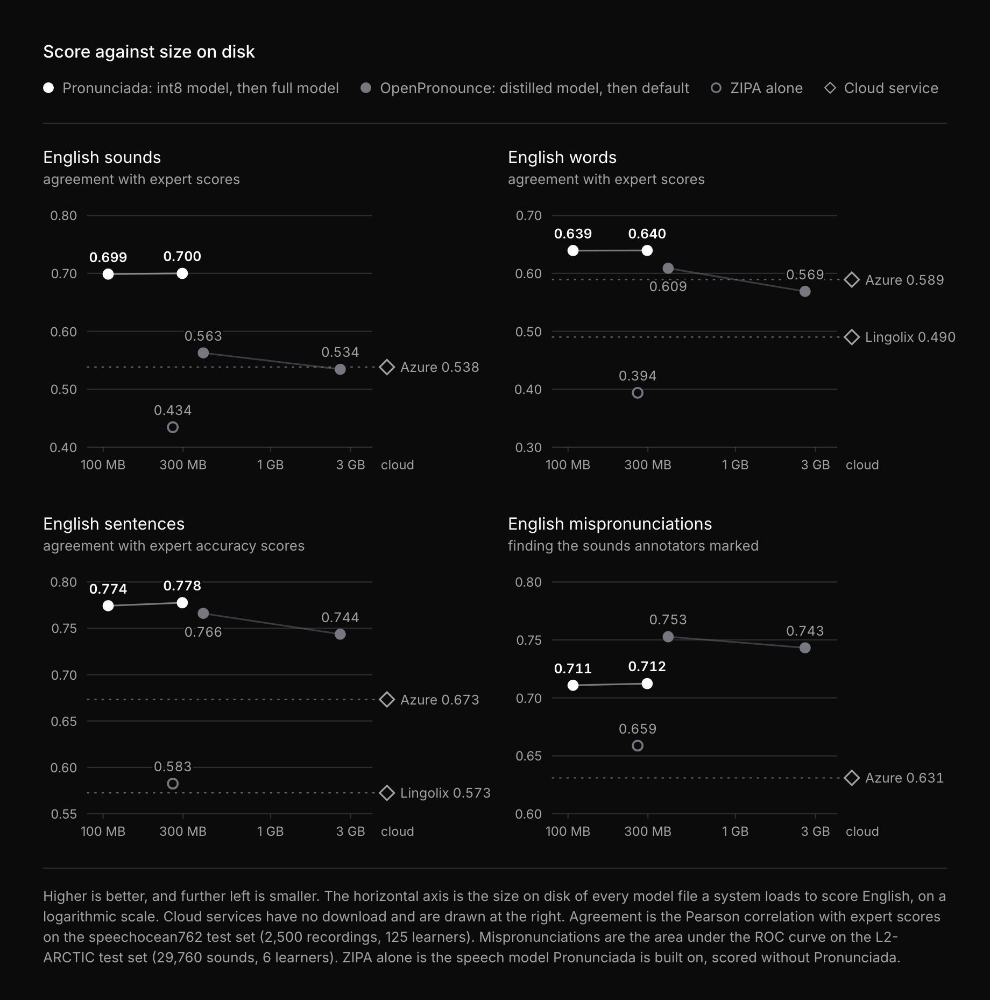
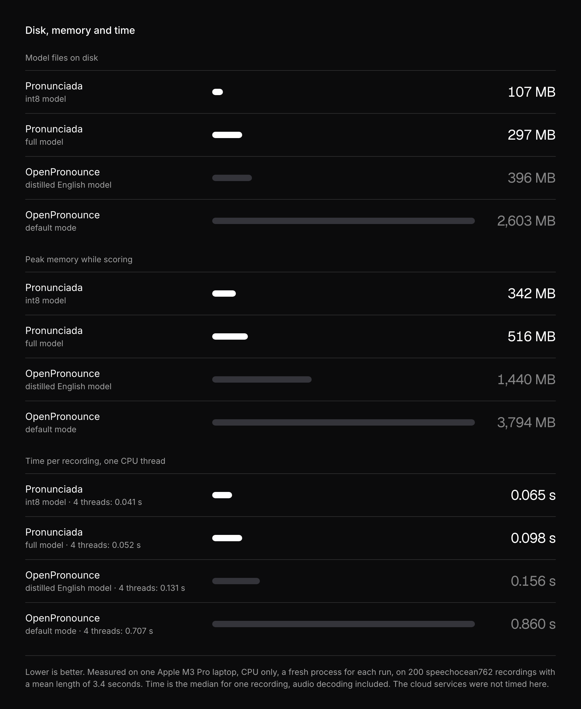

# Benchmark on real learner speech, four languages

Date of the runs: 23 November 2026; TonePerfect, OpenPronounce 0.4.0 and the combined score added on 25 November. Every number on this page was measured on recordings of real
learners and native speakers; there is no synthetic speech in it. All systems were scored on the same
recordings with the same labels; nothing was fitted, tuned or selected on any of this data. The
metric definitions for the new German data were committed (fee7f47) before any system was run on it.

**Scope.** The comparison covers complete pronunciation-assessment systems: packaged systems (library,
app or API) that take a recording and the text that was read and return scores at sound, word and
sentence level. Single-task research models, general speech models and small hobby tools are outside
its scope. One reference row, "ZIPA alone", is added: it is the phone model Pronunciada is built on,
scored without any of Pronunciada's components, and shows what Pronunciada adds to its backbone. It is
not an assessment system.

Reproduce every table from the cached outputs:
`LEARNERBENCH_EXTRA=pronunciada-nb8-sym-b128 python -m bench.learnerbench.report` (full sets) and the same
with `--only chivox` (the Chivox sample). Generated tables:
`results/tables/learner_benchmark_results.json`, `learner_benchmark_tables.md` (every row, every
system, intervals and paired differences), `learner_benchmark_sample.json` / `_sample_tables.md`,
`learner_benchmark_systems.json`, `learner_benchmark_cost/`.

## Added on 25 November 2026

- **TonePerfect** (API version 2, fallback off) measured by us on all 745 OMPAL test recordings and on 1,725
  speechocean762 test recordings chosen with every speaker represented (1,722 answered, 3 rejected as
  unassessable). Tables: `tables/learner_benchmark_sample_toneperfect.json` and `_tables.md`. TonePerfect
  states that it used other OMPAL recordings during its development.
- **OpenPronounce 0.4.0**, the release that was current when Pronunciada 1.0.0 came out (17 November 2026),
  run on every set here with its default settings and the Piper reference voice
  (`bench/rivals/openpronounce_040.py`); size, memory and time in `learner_benchmark_cost/quiet/`.
- **A combined score**: the unweighted mean over languages of one concordance C per language (0.5 = chance,
  1 = perfect): English, the system's sentence accuracy score against the experts' sentence accuracy on
  speechocean762; Mandarin, the same against the teachers' mean accuracy on OMPAL (learners); Spanish and
  German, the primary native-against-learner tests of Heroico / USMA and LeaP. Each system is compared with
  Pronunciada (full model) on the languages both cover, with speakers resampled within language (10,000
  replicates, paired). The English part was chosen after the earlier summaries had been seen (they use the
  sentence total); those summaries are unchanged in section 4.

| compared with | languages | Pronunciada | other | difference [95 % CI] | p |
|---|---|---|---|---|---|
| Azure | English, Mandarin, Spanish | 0.760 | 0.681 | +0.079 [+0.047, +0.118] | < 0.001 |
| Lingolix | English, Spanish | 0.759 | 0.682 | +0.077 [-0.009, +0.150] | 0.08 |
| TonePerfect (English: 1,722 of 2,500 recordings) | English, Mandarin | 0.805 | 0.727 | +0.078 [+0.056, +0.100] | < 0.001 |
| Chivox (299 + 299 recordings) | English, Mandarin | 0.788 | 0.679 | +0.109 [+0.071, +0.144] | < 0.001 |
| OpenPronounce 1.1.0, default | English, Spanish, German | 0.749 | 0.715 | +0.034 [-0.026, +0.105] | 0.27 |
| OpenPronounce 1.1.0, distilled | English | 0.849 | 0.828 | +0.021 [+0.011, +0.032] | < 0.001 |
| OpenPronounce 0.4.0 | English, Spanish, German | 0.749 | 0.745 | +0.003 [-0.033, +0.045] | 0.83 |
| ZIPA alone | English, Mandarin, Spanish, German | 0.752 | 0.622 | +0.129 [+0.081, +0.167] | < 0.001 |

On English, Spanish and German together, every on-device system: Pronunciada int8 0.754,
Pronunciada full 0.749, OpenPronounce 1.1.0 default 0.715,
OpenPronounce 0.4.0 0.745, ZIPA alone 0.623.

Four constructions of the score were fixed and computed to see how much the result depends on them
(`bench/learnerbench/combined_variants.py`, `tables/learner_benchmark_combined_variants*.json`): as above;
languages weighted by their number of speakers; every level the judges scored (English sounds, words,
sentence accuracy, L2-ARCTIC and EpaDB; Mandarin characters and sentence accuracy); and both. Pronunciada
stays ahead of every commercial system in all four. Against OpenPronounce 1.1.0 the difference is not
significant in any of them, and in the two that include every level its distilled English model is ahead
by 0.005 (not significant).

The same results as a page: <https://pronunciada.dev/benchmarks/>.

## 1. The suite

| set | lang | speakers | items | hours | label type | licence | what it can show | what it cannot show |
|---|---|---|---|---|---|---|---|---|
| speechocean762 test | en | 125 learners (Mandarin L1, many children) | 2,500 | 2.69 | expert scores (5 raters) for sounds, words, sentences | Apache-2.0 | agreement with experts at every level | other L1s; adults only partly |
| L2-ARCTIC test | en | 6 learners (6 L1s) | 900 | 0.88 | annotator-marked mispronounced sounds | CC BY-NC 4.0 (evaluation only) | sound-level error detection | only 6 speakers: wide intervals |
| EpaDB test | en | 20 learners (Spanish L1) | 1,263 | 1.10 | marked mispronounced sounds | sources disagree: CC BY-NC 4.0 or ODC-By 1.0 (evaluation only) | sound-level error detection | one L1 |
| Speech Accent Archive | en | 200 (100 natives, 100 learners, 59 L1s) | 200 paragraphs (153 of ≤ 30 s) | 1.51 | native vs learner | CC BY-NC-SA 4.0 | separation of natives from learners on one text | pronunciation quality as such; speaking rate also differs |
| LeaP English (new) | en | 50 (4 natives, 46 learners, 16 L1s) | 700 sentences | 0.79 | native vs learner; group codes; age of onset | no licence stated (evaluation only) | as above, on a story read aloud | 4 natives only |
| OMPAL test | zh | 21 (18 learners French L1, 3 natives) | 745 | 1.15 | teacher scores per sentence, teacher marks per character | CC BY 4.0 | agreement with teachers; tone and sound errors | one L1, 18 learners |
| Heroico / USMA | es | 48 (10 learners, 8 + 30 natives) | 600 | 0.37 | native vs learner, same prompts | OpenSLR says Apache-2.0, LDC says its user agreement (evaluation only) | separation on the same short prompts | 10 learners; recording conditions differ |
| LeaP German (new) | de | 53 (7 natives, 46 learners, 18 L1s) | 742 sentences | 0.87 | native vs learner; group codes; age of onset | no licence stated (evaluation only) | separation on the same stories | 7 natives; no expert scores |

The round-19 suite (speechocean762, Speech Accent Archive, OMPAL test half, Heroico / USMA) is unchanged
(`suite_test.jsonl` is byte-identical); `suite4_test.jsonl` adds LeaP. L2-ARCTIC and EpaDB are the
scoreboard's held-out test splits. Secondary only: 405 later readings of 28 LeaP learners (after a stay
abroad or a prosody course), `prepost.jsonl`.

### German: how LeaP was built

Source: the LeaP corpus (Learning Prosody in a Foreign Language, Universität Bielefeld 2001-2003),
direct download from SourceForge (`LeaP corpus - German.zip`, 1,518,787,812 bytes, sha256
e336a8aa…118999; `LeaP corpus - English.zip`, sha256 6ea8a4b4…62e96d as published; manual sha256
0428f37d…676eb6). **The corpus states no licence anywhere** (SourceForge page and manual). It is used
here for evaluation only; no audio, text, annotation or per-recording output from it is committed or
redistributed, and the story texts are read from the manual at build time. Builder:
`bench/learners/leap.py`.

- Read speech only: German stories B and C, English story A, with the text printed in the manual's
  appendix. Retellings, interviews and nonsense word lists are not used.
- Cut into sentences mechanically, with no manual edits: the story text is split at sentence-final
  punctuation (pieces under 4 words joined to the next); the corpus' own word tier (Praat TextGrid) is
  aligned to the story words by edit distance; an item runs from the first to the last word of the
  sentence, widened by up to 0.15 s but never past the midpoint of the gap to the neighbouring word.
  The item text is the sentence as printed.
- Exclusions (counted): German 114 sentence items whose first or last word is missing from the word
  tier, and one partial reading (one learner's first recording covers less than half of the story;
  that speaker's next reading is used); English 145 items for the same edge-word reason and 5 with
  more read deviations than half the sentence. Of 69 German read recordings, 68 are used; all 65 English read recordings in the archive are used.
- Test selection (seed 23): one reading per speaker (natives, then very advanced learners, then the
  first reading of the others); up to 14 sentences per speaker, rotated so that every sentence is read
  by several natives and several learners. German: 742 items, 42 prompts, 53 speakers (story B: 4
  natives, 10 learners; story C: 3 natives, 36 learners). English: 700 items, 22 prompts, 50 speakers.
- Metadata: the corpus gives no proficiency rating and no self-rating. It gives group codes (native;
  "superlearner" = very advanced learner; before / after a stay abroad; before / after a prosody
  course) and age of onset. These feed only the pre-declared secondary analysis.
- Outcome: the German read-aloud part is usable, but small on the native side (7 natives, split over two
  stories). The English learner readings were equally usable and form a second English
  native-vs-learner set (4 natives).

## 2. Systems

| system | category | version | licence (code / weights) | parameters | weights on disk | en | zh | es | de | levels given |
|---|---|---|---|---|---|---|---|---|---|---|
| Pronunciada fp32 (default) | open assessment system | 1.1.0 (scored at `main` fce7918; outputs identical in the release) | Apache-2.0 / ZIPA CC BY 4.0 | about 67 M | 297 MB | yes | yes | yes | yes | sound, word, sentence |
| Pronunciada int8 | open assessment system | same, shipped int8 backbone | same | about 67 M | 107 MB | yes | yes | yes | yes | sound, word, sentence |
| OpenPronounce 1.1.0, default | open assessment system | 1.1.0 (latest release, PyPI wheel) | AGPL-3.0 / Apache-2.0 models | 631 M (English: phone + word recognizer) | 2,603 MB (English) | yes | not supported | yes (experimental) | yes (experimental) | sound, word, sentence |
| OpenPronounce 1.1.0, distilled English phone model | open assessment system | 1.1.0 + `wav2vec2-base-phones-en` @ 2e12ec2 | AGPL-3.0 / AGPL-3.0 | 95 M | 396 MB | yes | not supported | not supported | not supported | sound, word, sentence |
| Azure Pronunciation Assessment | commercial, cached responses | REST, westus, Nov 2026 | commercial | – | cloud | yes | yes | yes | not run | sound, word, sentence |
| Lingolix | commercial, cached responses | model 2026-11 | commercial | – | cloud | yes (speechocean762) | not supported | yes (Heroico, 2026-11-23) | not run | syllable, word, sentence |
| Chivox | commercial, 299-item samples | engines eng.snt.G4.N1.0.13, chn.snt.G4.A2.0.8 | commercial | – | cloud | sample | sample | not run | not run | word, sentence (no sounds in English) |
| Pronunciada, on-device model (73 MB, candidate) | open assessment system, **candidate, not released** | `main` with `PRONUNCIADA_BACKBONE` = nb8-sym-b128 (fp32 backbone, 8-bit weights, fp32 compute; 73,442,981 bytes, sha1 d6987da1…) | as fp32 | about 67 M | 110 MB (73.4 MB backbone) | yes | yes | yes | yes | sound, word, sentence |
| ZIPA alone (reference) | reference phone model | zipa-small-crctc-500k fp32, recipe `bench/eval_zipa_baseline.py` "gop" | CC BY 4.0 | 64 M | 260 MB | scored | scored | scored | scored | sound, word, sentence (recipe) |

What each system was given: the recording and the prompt text; each system's own text front end made
the phones, except ZIPA alone, which uses Pronunciada's canonical phones as its recipe prescribes.
Scores used at each level (fixed from the documentation before results were looked at; details in
`results/tables/learner_benchmark_systems.json`):
- Pronunciada: sound = the sound model's 0-2 output (Pearson), 1 − `PhoneResult.prob` (detection);
  word = word output; sentence = `scores` total / accuracy / fluency / prosodic; the suite's sentence
  score is `scores["total"]`; OMPAL characters = min `WordResult.prob`.
- OpenPronounce: sound = 100 (1 − p) of its phone model for the expected sound, aligned to the
  reference sounds; word = 100 (1 − p) of its word model; sentence = `score` and its sub-scores. Run
  offline (Piper reference voice instead of the online gTTS default; it feeds only the pre-1.0
  formula score, which is not used). Its own venv; never imported into Pronunciada's.
- Azure: phoneme / word AccuracyScore; PronScore (suite) and the sentence aspects (speechocean762);
  AccuracyScore (OMPAL). Lingolix: word accuracy; utterance `overall`. Chivox: as mapped in
  `results/chivox_harness.md`.
- ZIPA alone: mean log-posterior of each canonical phone over its CTC-aligned frames; word = mean of
  its sounds; sentence = mean of all sounds, used for every sentence-level test.

Reuse and checks. OpenPronounce's speechocean762, L2-ARCTIC and EpaDB outputs are the round-19 runs
(same release, same model revisions ae45363 / bdeaacd / 2e12ec2); 40 of them were re-run here in a
newly built venv and matched to the last digit on every score, sub-score, word and sound probability.
L2-ARCTIC / EpaDB default-mode rows use the `--fast` outputs, which round 19 found identical to default
mode on 5,200 records (10 of the re-runs above confirm it again). The learner corpora (Speech Accent
Archive, Heroico, LeaP) were scored here: 3,748 records, 0 failures. Pronunciada fp32 and int8 were
re-scored on all 8,055 items with `main` (package fingerprint 6b418b1526ff946d), so its numbers differ
from round 19's 1.0.2 cache on several rows. ZIPA alone reproduces its published README figures
exactly (speechocean762 sound 0.434, word 0.394, sentence accuracy 0.583; L2-ARCTIC 0.659; EpaDB 0.638;
OMPAL 0.602). Azure and OpenPronounce reproduce their round-19 / scoreboard figures exactly. Failures:
none for any system on any item.

## 3. Results

Statistics for every row: 95 % percentile intervals from 10,000 bootstrap resamples of speakers; every
difference Δ = Pronunciada fp32 minus the other system, paired on the same resamples, two-sided p. "–"
= no number (reason in the generated tables). Higher is better in every row.

### English: speechocean762 test (expert scores, 125 speakers)

| level (Pearson unless noted) | n | Pronunciada fp32 | int8 | OpenPronounce | OP student | Azure | Lingolix | ZIPA alone |
|---|---|---|---|---|---|---|---|---|
| sound | 47,369 | **0.700** [0.631, 0.746] | 0.699 | 0.534 (Δ +0.165, p < 0.001) | 0.563 (+0.137, < 0.001) | 0.538 (+0.162, < 0.001) | – (no sound level) | 0.434 (+0.265, < 0.001) |
| sound, Spearman | 47,369 | 0.471 [0.439, 0.505] | 0.469 | 0.482 (−0.011, p 0.029) | **0.496** (−0.025, < 0.001) | 0.339 (+0.132, < 0.001) | – | 0.309 (+0.163, < 0.001) |
| word | 15,967 | **0.640** [0.562, 0.696] | 0.639 | 0.569 (+0.071, < 0.001) | 0.609 (+0.031, 0.019) | 0.589 (+0.050, 0.009) | 0.490 (+0.149, < 0.001) | 0.394 (+0.246, < 0.001) |
| word, Spearman | 15,967 | 0.420 [0.366, 0.471] | 0.420 | 0.387 (+0.033, < 0.001) | 0.397 (+0.023, < 0.001) | 0.417 (+0.003, 0.52) | **0.443** (−0.023, 0.006) | 0.350 (+0.070, < 0.001) |
| sentence total | 2,500 | 0.792 [0.742, 0.832] | 0.789 | 0.790 (+0.001, 0.86) | **0.802** (−0.010, 0.74) | 0.796 (−0.004, 0.93) | 0.668 (+0.123, < 0.001) | 0.614 (+0.177, < 0.001) |
| sentence total, Spearman | 2,500 | **0.767** [0.712, 0.809] | 0.764 | 0.727 (+0.040, < 0.001) | 0.730 (+0.037, < 0.001) | 0.762 (+0.004, 0.61) | 0.640 (+0.127, < 0.001) | 0.619 (+0.148, < 0.001) |
| sentence accuracy | 2,500 | **0.778** [0.724, 0.818] | 0.774 | 0.744 (+0.034, 0.006) | 0.766 (+0.012, 0.25) | 0.673 (+0.104, < 0.001) | 0.573 (+0.205, < 0.001) | 0.583 (+0.195, < 0.001) |
| sentence fluency | 2,500 | 0.814 [0.753, 0.864] | 0.814 | 0.827 (−0.012, 0.81) | **0.837** (−0.023, 0.60) | 0.708 (+0.106, 0.004) | – | 0.562 (+0.253, < 0.001) |
| sentence prosody | 2,500 | 0.805 [0.746, 0.852] | 0.805 | 0.808 (−0.003, 0.98) | 0.821 (−0.016, 0.72) | **0.827** (−0.022, 0.48) | – | 0.588 (+0.217, < 0.001) |
| sentence total, concordance C | 2,500 | 0.855 [0.833, 0.872] | 0.854 | 0.835 (+0.020, 0.001) | 0.837 (+0.018, < 0.001) | 0.855 (−0.000, 0.99) | 0.786 (+0.069, < 0.001) | 0.772 (+0.083, < 0.001) |

Spearman rows of fluency and prosody: Pronunciada ahead of both OpenPronounce rows (+0.032 to +0.046, all
p ≤ 0.002), level with Azure on prosody (+0.013, p 0.22), ahead of Azure on fluency (+0.195). Pronunciada
int8 is within 0.004 of fp32 on every row here.

### English: marked mispronounced sounds (L2-ARCTIC test, EpaDB test)

| test | n sounds (marked) | Pronunciada fp32 | int8 | OpenPronounce | OP student | Azure | ZIPA alone |
|---|---|---|---|---|---|---|---|
| L2-ARCTIC, AUC (6 speakers) | 29,760 (4,114 marked) | 0.712 [0.651, 0.758] | 0.711 | 0.743 (Δ −0.031, p < 0.001) | **0.753** (−0.040, < 0.001) | 0.631 (+0.081, < 0.001) | 0.659 (+0.054, < 0.001) |
| EpaDB, AUC (20 speakers) | 20,665 (4,131 marked) | 0.721 [0.706, 0.735] | 0.717 | **0.741** (−0.019, 0.001) | 0.739 (−0.018, < 0.001) | 0.587 (+0.135, < 0.001) | 0.638 (+0.083, < 0.001) |
| L2-ARCTIC, F1 at the system's own decision | | 0.109 [0.022, 0.201] | 0.110 | – | – | – | – |
| EpaDB, F1 at the system's own decision | | 0.083 [0.052, 0.112] | 0.086 | – | – | – | – |

F1: only Pronunciada outputs a per-sound decision (a sound is flagged when its probability of being
acceptable is below 0.5 at default strictness). At that point it flags few sounds, hence the low F1;
OpenPronounce flags words, not sounds, and Azure gives scores only. Lingolix: no cached responses.

### Mandarin: OMPAL test (teacher scores and marks)

| test | n | Pronunciada fp32 | int8 | Azure | ZIPA alone |
|---|---|---|---|---|---|
| character with any error, AUC (21 speakers) | 8,156 | **0.790** [0.747, 0.837] | 0.788 | 0.704 (Δ +0.086, p < 0.001) | 0.602 (+0.188, < 0.001) |
| sentence accuracy, Pearson (18 learners) | 663 | **0.634** [0.456, 0.743] | 0.635 | 0.363 (+0.272, < 0.001) | 0.302 (+0.333, < 0.001) |
| sentence accuracy, Spearman | 663 | **0.638** | 0.639 | 0.424 (+0.214, < 0.001) | 0.308 (+0.330, < 0.001) |
| sentence total vs teacher accuracy, C (LS metric) | 663 | **0.639** [0.569, 0.688] | 0.641 | 0.573 (+0.066, < 0.001) | 0.620 (+0.019, 0.57) |
| native vs learner, prompt-matched AUC (3 natives) | 745 | **0.967** | 0.953 | 0.953 (+0.014, 0.61) | 0.786 (+0.181, 0.001) |

OpenPronounce, its student, and Lingolix do not support Mandarin. The −duration baseline on the native
vs learner row reaches 0.970: with 3 natives this row says little.

### Spanish: Heroico / USMA (native vs learner, same prompts)

| test | n | Pronunciada fp32 | int8 | OpenPronounce | Azure | Lingolix (measured by us, 2026-11-23) | ZIPA alone | −duration |
|---|---|---|---|---|---|---|---|---|
| USMA, prompt-matched AUC (primary; 8 natives, 10 learners) | 450 | **0.669** [0.503, 0.815] | 0.683 | 0.587 (Δ +0.082, p 0.35) | 0.581 (+0.088, 0.065) | 0.603 (+0.066, 0.41) | 0.590 (+0.079, 0.26) | 0.386 |
| USMA, speaker-level AUC | 18 | 0.850 [0.600, 1.000] | 0.838 | 0.613 (+0.237, 0.020) | 0.575 (+0.275, 0.029) | **0.863** (−0.013, 1.00) | 0.787 (+0.062, 0.70) | |
| + 30 HEROICO natives, AUC | 600 | 0.618 [0.490, 0.736] | **0.630** | 0.603 (+0.016, 0.87) | 0.542 (+0.077, 0.063) | 0.541 (+0.078, 0.19) | 0.572 (+0.046, 0.38) | 0.420 |
| + 30 HEROICO natives, speaker-level AUC | 48 | 0.629 | **0.642** | 0.637 (−0.008, 0.90) | 0.437 (+0.192, 0.018) | 0.539 (+0.089, 0.22) | 0.624 (+0.005, 0.95) | |

Lingolix on Heroico: 0.603 and 0.541 on the two AUC rows, the same as the coordinator's check;
Pronunciada 0.669 / 0.618 and Azure 0.581 / 0.542 agree as well. None of the item-level differences is
significant; 10 learners and 8 natives give wide intervals.

### German: LeaP (native vs learner, same stories; new)

| test | n | Pronunciada fp32 | int8 | OpenPronounce | ZIPA alone | −duration |
|---|---|---|---|---|---|---|
| prompt-matched AUC (primary; 7 natives, 46 learners) | 742 | 0.728 [0.619, 0.825] | 0.733 | **0.738** (Δ −0.010, p 0.84) | 0.509 (+0.218, 0.009) | 0.706 |
| per-prompt (macro) AUC | 742 | 0.706 [0.620, 0.788] | **0.721** | 0.695 (+0.011, 0.66) | 0.504 (+0.203, 0.005) | |
| speaker-level AUC | 53 | 0.904 [0.787, 0.990] | **0.907** | 0.848 (+0.056, 0.55) | 0.708 (+0.196, 0.039) | |
| items read exactly as printed, AUC | 591 | 0.691 | 0.699 | **0.713** (−0.022, 0.72) | 0.521 (+0.169, 0.022) | 0.662 |
| story B only (4 natives, 10 learners, 8 of them very advanced) | 196 | 0.661 | 0.705 | 0.578 (+0.084, 0.32) | 0.563 | **0.869** |
| story C only (3 natives, 36 learners) | 546 | 0.756 | 0.744 | **0.805** (−0.050, 0.29) | 0.487 | 0.637 |

Azure, Lingolix and Chivox: not run on German (no cached responses). The OpenPronounce student model is
English only. On story B, where almost every learner is a "very advanced" learner, reading time alone
separates the groups better than any system.

### English: Speech Accent Archive and LeaP English (native vs learner)

| test | n | Pronunciada fp32 | int8 | OpenPronounce | OP student | Azure | ZIPA alone | −duration |
|---|---|---|---|---|---|---|---|---|
| Speech Accent Archive, ≤ 30 s, AUC (94 / 59) | 153 | 0.851 [0.787, 0.906] | **0.877** | 0.732 (Δ +0.119, p 0.001) | 0.769 (+0.082, 0.004) | 0.750 (+0.101, 0.002) | 0.824 (+0.027, 0.45) | 0.698 |
| Speech Accent Archive, all 200, AUC | 200 | 0.881 | **0.895** | 0.810 (+0.071, 0.001) | 0.831 (+0.050, 0.006) | – (47 clips over Azure's 30 s limit) | 0.830 (+0.051, 0.055) | 0.786 |
| LeaP English, prompt-matched AUC (4 / 46) | 700 | 0.829 [0.714, 0.905] | **0.831** | 0.714 (+0.115, 0.037) | 0.696 (+0.133, 0.003) | not run | 0.604 (+0.225, < 0.001) | 0.810 |
| LeaP English, per-prompt AUC | 700 | **0.844** | 0.844 | 0.740 (+0.104, 0.032) | 0.722 (+0.122, 0.002) | not run | 0.604 (+0.240, < 0.001) | |
| LeaP English, speaker-level AUC | 50 | **0.918** | 0.918 | 0.870 (+0.049, 0.58) | 0.815 (+0.103, 0.21) | not run | 0.636 (+0.283, 0.037) | |
| LeaP English, exact readings, AUC | 497 | **0.780** | 0.778 | 0.647 (+0.133, 0.043) | 0.657 (+0.123, 0.074) | not run | 0.603 (+0.177, 0.011) | 0.779 |

Compared with round 19 (Pronunciada 1.0.2 cache: 0.678 on the ≤ 30 s set), the current `main` scores
separate the Speech Accent Archive groups much better (0.851) and now beat duration alone (0.698).
LeaP English still sits close to duration alone (0.829 against 0.810).

### Pre-declared secondary: proficiency signals in LeaP

| test | n | Pronunciada fp32 | OpenPronounce | OP student | ZIPA alone |
|---|---|---|---|---|---|
| de: very advanced learners vs other learners, prompt-matched AUC (expected > 0.5) | 644 | **0.767** [0.675, 0.848] | 0.522 (Δ +0.244, p 0.001) | – | 0.593 (+0.174, 0.042) |
| de: learner mean score vs age of onset, Spearman (expected < 0) | 46 | **−0.481** [−0.718, −0.165] | −0.295 [−0.588, +0.044] | – | −0.426 |
| en: very advanced vs other learners, AUC | 644 | **0.792** [0.673, 0.903] | 0.705 (+0.087, 0.094) | 0.684 (+0.108, 0.003) | 0.543 (+0.248, < 0.001) |
| en: learner mean score vs age of onset, Spearman | 46 | **−0.296** [−0.579, +0.023] | −0.151 | −0.257 | +0.134 |
| de: later reading minus first reading, same sentences (15 speakers) | 204 | +0.003 [−0.004, +0.011] (0-1 scale) | +1.26 [+0.42, +2.07] (0-100 scale) | – | +0.008 |
| en: later minus first (13 speakers) | 201 | +0.002 [−0.002, +0.006] | −0.01 [−1.04, +1.03] | +0.20 [−0.51, +0.98] | −0.019 |

The later-minus-first rows have no expected sign (the courses taught prosody) and the systems use
different scales, so their Δ is not meaningful; Pronunciada sees no change, OpenPronounce default a
small rise in German.

### Sample table: Chivox (measured by us on a 299-recording sample per language, free pilot)

Chivox was measured on 299 speechocean762 test recordings (125 speakers) and 299 OMPAL test recordings
(21 speakers), a seeded, speaker-balanced pilot, on 2026-11-23. Three facts the reader needs: Chivox's
endpoint accepts only MP3, so it received 64 kbit/s MP3 while every other system scored the original
audio; its English sentence engine returns no sound-level scores, so that cell is "—"; settings were the
documented defaults. Every system below is compared on exactly those items; these rows are not mixed
into the full-set tables above.

| test (sample) | n | Pronunciada fp32 | int8 | OpenPronounce | OP student | Azure | Lingolix | ZIPA alone | Chivox |
|---|---|---|---|---|---|---|---|---|---|
| en sound, Pearson | 5,679 | **0.689** | 0.692 | 0.533 | 0.552 | 0.512 | – | 0.427 | — |
| en word, Pearson | 1,909 | **0.603** | 0.595 | 0.581 | 0.564 | 0.566 | 0.477 | 0.393 | 0.517 (Δ +0.086, p 0.036) |
| en sentence total, Pearson | 299 | 0.789 | 0.780 | 0.779 | 0.767 | **0.802** (−0.013, 0.68) | 0.695 | 0.622 | 0.644 (+0.145, < 0.001) |
| en sentence accuracy | 299 | **0.772** | 0.762 | 0.715 | 0.733 | 0.672 | 0.642 | 0.602 | 0.529 (+0.243, < 0.001) |
| en sentence fluency | 299 | **0.850** | 0.847 | 0.792 | 0.841 | 0.706 | – | 0.571 | 0.647 (+0.203, < 0.001) |
| en sentence prosody | 299 | 0.832 | 0.828 | 0.789 | 0.820 | **0.840** (−0.009, 0.67) | – | 0.599 | 0.492 (+0.339, < 0.001) |
| zh character, any error, AUC | 3,022 | **0.805** | 0.802 | – | – | 0.695 | – | 0.604 | 0.690 (+0.114, < 0.001) |
| zh character, consonant or vowel error, AUC | 3,022 | 0.812 | 0.822 | – | – | 0.773 | – | 0.809 | **0.828** (−0.016, 0.55) |
| zh character, tone-only error, AUC | 3,022 | **0.803** | 0.798 | – | – | 0.678 | – | 0.561 | 0.660 (+0.143, < 0.001) |
| zh sentence accuracy, Pearson (learners) | 257 | **0.589** | 0.588 | – | – | 0.214 | – | 0.226 | 0.391 (+0.199, 0.003) |
| zh sentence fluency, Pearson (learners) | 257 | 0.558 | 0.565 | – | – | 0.243 | – | 0.142 | **0.620** (−0.062, 0.28) |

Chivox's own figures agree with the pilot report (`results/chivox_live.md`). That report's Pronunciada
column (English total 0.753, accuracy 0.733, words 0.570) comes from the round-19 1.0.2 cache; the
column here is the current `main` run (0.789, 0.772, 0.603). Mandarin figures agree within 0.003.

### Pronunciada, on-device model (73 MB, candidate) against fp32

The candidate backbone `nb8-sym-b128` (not released) was run on all 8,055 items with everything else
unchanged. It appears in every generated table (`results/tables/learner_benchmark_tables.md`). Against
fp32, paired on the same speaker resamples:

| test (metric) | fp32 | candidate | Δ (fp32 − candidate) |
|---|---|---|---|
| speechocean762 sound / word / sentence total (Pearson) | 0.700 / 0.640 / 0.792 | 0.701 / 0.641 / 0.793 | −0.001 / −0.001 / −0.001 (p 0.29 / 0.25 / 0.13) |
| speechocean762 sentence accuracy / fluency / prosody | 0.778 / 0.814 / 0.805 | 0.778 / 0.815 / 0.806 | all within 0.001, p ≥ 0.29 |
| speechocean762 sentence total, C | 0.855 | 0.856 | −0.001 (p 0.008) |
| L2-ARCTIC / EpaDB marked sounds (AUC) | 0.712 / 0.721 | 0.712 / 0.722 | +0.000 (p 0.58) / −0.001 (p < 0.001) |
| OMPAL character any error (AUC) / sentence accuracy (Pearson) | 0.790 / 0.634 | 0.790 / 0.634 | +0.000 / +0.000 |
| Heroico USMA AUC | 0.669 | 0.672 | −0.004 (p 0.73) |
| Speech Accent Archive ≤ 30 s AUC | 0.851 | 0.853 | −0.002 (p 0.60) |
| LeaP German AUC / LeaP English AUC | 0.728 / 0.829 | 0.728 / 0.827 | +0.000 (p 1.00) / +0.002 (p 0.74) |
| LS4 / LS-NL4 | 0.723 / 0.804 | 0.723 / 0.805 | −0.001 (p 0.72) / −0.001 (p 0.67) |

The largest difference on any row is on LeaP German story B speaker level (14 speakers: 0.875 against
0.925, p 0.65). The only significant differences are of 0.001 to 0.003: the candidate is higher on
speechocean762 C and Spearman total and on EpaDB, lower on the Chivox-sample OMPAL sentence accuracy
(0.586 against 0.589, p 0.002). On these learner tests the 73 MB candidate scores as fp32 does.

## 4. Summaries (pre-registered formula, extended to four languages)

LS = unweighted mean over languages of the primary concordance: en speechocean762 (C vs expert total),
zh OMPAL (C vs teacher accuracy), es Heroico USMA (prompt-matched AUC), de LeaP German (prompt-matched
AUC). LS-NL = the same with each language's native-vs-learner AUC (en Speech Accent Archive ≤ 30 s).
Speakers resampled within each language. A system that does not support or was not run on a language
gets no four-language summary; it is compared on the languages it covers.

| summary | languages | speakers | items | Pronunciada fp32 | int8 | other system | Δ (fp32 − other) |
|---|---|---|---|---|---|---|---|
| **LS4** | en, zh, es, de | 214 | 4,355 | **0.723** [0.668, 0.769] | 0.727 [0.670, 0.777] | ZIPA alone 0.623 [0.586, 0.658] | +0.100 [+0.050, +0.141], p 0.001 |
| LS-NL4 | en, zh, es, de | 245 | 2,090 | **0.804** [0.750, 0.851] | 0.811 | ZIPA alone 0.677 | +0.126 [+0.066, +0.179], p < 0.001 |
| LS (round-19 languages) | en, zh, es | 161 | 3,613 | **0.721** [0.659, 0.773] | 0.726 | Azure 0.670 [0.616, 0.717] | +0.051 [+0.018, +0.086], p 0.003 |
| LS-NL (round-19 languages) | en, zh, es | 192 | 1,348 | **0.829** | 0.838 | Azure 0.761 | +0.068 [+0.025, +0.113], p 0.004 |
| LS, OpenPronounce's languages | en, es, de | 196 | 3,692 | **0.750** [0.684, 0.808] | 0.756 | OpenPronounce 0.720 [0.616, 0.805] | +0.031 [−0.029, +0.100], p 0.33 |
| LS-NL, OpenPronounce's languages | en, es, de | 224 | 1,345 | **0.749** | 0.764 | OpenPronounce 0.685 | +0.064 [−0.000, +0.138], p 0.053 |

int8 against fp32: LS4 −0.005 [−0.021, +0.008] (p 0.44), LS-NL4 −0.008 (p 0.34) in int8's favour, not
significant. The on-device candidate: LS4 0.723 [0.670, 0.770], LS-NL4 0.805, Δ −0.001 on both (p 0.72,
0.67). No LS4 exists for any other system: OpenPronounce does not support Mandarin, Azure has no
German responses, Lingolix supports neither Mandarin nor was run on German or Speech Accent Archive.

## 5. Cost on the same machine

`python -m bench.ondevice`, fresh process per run, CPU only, first 200 speechocean762 test clips (mean
3.4 s), audio decoding inside the timed call; Apple M3 Pro. The Pronunciada int8 and fp32 rows and the
OpenPronounce student row were measured back to back between 17:26 and 17:31 on 23 Nov with the code
that merges this benchmark, the optimization work and the one-backbone-file cache layout (one file per
precision on disk), at a 1-minute load average of 2.5 to 4.2 (the machine is shared; the load column
gives the value before and after each run, both thread counts); files in
`results/tables/learner_benchmark_cost/quiet/`. The candidate and OpenPronounce default rows come from
the earlier pass at 15:08-15:17 (load 1.8 to 3.9, `main` fce7918; `rerun/` and `nb8-sym-b128/`), where
int8 and fp32 gave 0.040 / 0.064 s and 0.049 / 0.097 s. A first pass at 14:31-14:47, under a load of 9
to 40, gave slower figures in the same order; it is kept in the files at the top level of
`results/tables/learner_benchmark_cost/`. Peak memory is that of the 4-thread run.

| system | parameters | weights on disk | peak memory (fresh process) | median s / clip, 4 threads | median s / clip, 1 thread | load avg |
|---|---|---|---|---|---|---|
| Pronunciada int8 | about 67 M | 107 MB (70.7 MB backbone) | 334 MB | **0.041** | **0.065** | 3.1-3.6 |
| Pronunciada fp32 | about 67 M | 297 MB (260.3 MB backbone) | 509 MB | 0.052 | 0.098 | 3.3-4.2 |
| Pronunciada, on-device model (73 MB, candidate) | about 67 M | 110 MB (73.4 MB backbone) | 337 MB | 0.058 | 0.133 | 2.8-3.9 |
| OpenPronounce student | 95 M | 396 MB | 1,430 MB | 0.131 | 0.156 | 2.5-3.0 |
| OpenPronounce default (English) | 631 M | 2,603 MB | 3,880 MB | 0.707 | 0.860 | 1.8-2.1 |
| ZIPA alone | 64 M | 260 MB | – | – | – | – |
| Azure, Lingolix, Chivox | – | cloud | – | – | – | – |

The candidate is smaller on disk and in memory than fp32 but slower per clip on this machine (0.058
against 0.049 s at 4 threads, 0.133 against 0.097 at 1 thread, same pass); int8 is the fastest at both
thread counts. OpenPronounce student takes 3.2 times as long as int8 per clip at 4 threads (0.131
against 0.041 s) and 2.4 times at 1 thread (0.156 against 0.065 s), in the same window.

ZIPA alone shares Pronunciada's backbone file; its size and speed are the backbone's (its run is the
backbone's forward pass plus a CTC alignment) and it was not timed separately. OpenPronounce default
mode for Spanish or German loads a third 1.26 GB recognizer, not measured. Weights: Pronunciada = the
ZIPA-small ONNX file + its package data; OpenPronounce = the checkpoints it loads + its package models
(+ the 63 MB Piper voice in default mode).

## 6. Where Pronunciada is behind

Every row where another system's point value is above Pronunciada fp32's, with the gap (Δ = fp32 − other).
Significant (p < 0.05):
- speechocean762 sound, Spearman: OpenPronounce 0.482 vs 0.471 (Δ −0.011, p 0.029); student 0.496
  (−0.025, p < 0.001). By Pearson Pronunciada is ahead of both (+0.165, +0.137).
- speechocean762 word, Spearman: Lingolix 0.443 vs 0.420 (−0.023, p 0.006). By Pearson Pronunciada is
  ahead (+0.149).
- L2-ARCTIC marked sounds, AUC: OpenPronounce 0.743 vs 0.712 (−0.031, p < 0.001); student 0.753
  (−0.040, p < 0.001).
- EpaDB marked sounds, AUC: OpenPronounce 0.741 vs 0.721 (−0.019, p 0.001); student 0.739 (−0.018,
  p < 0.001).
- Chivox sample, speechocean762 sound Spearman: OpenPronounce 0.474 vs 0.455 (−0.020, p 0.048); student
  0.481 (−0.026, p 0.004).
- Pronunciada int8 above fp32: Speech Accent Archive ≤ 30 s 0.877 vs 0.851 (−0.026, p 0.033).
- Pronunciada on-device candidate above fp32 by 0.001: speechocean762 C (p 0.008) and Spearman total
  (p 0.018), EpaDB AUC (p < 0.001).

Not significant:
- speechocean762 sentence total: student 0.802 (−0.010), Azure 0.796 (−0.004); C: Azure equal (0.855).
  Fluency: OpenPronounce 0.827 (−0.012), student 0.837 (−0.023). Prosody: OpenPronounce 0.808 (−0.003),
  student 0.821 (−0.016), Azure 0.827 (−0.022).
- Heroico USMA speaker-level AUC: Lingolix 0.863 vs 0.850 (−0.013). Heroico + HEROICO natives speaker
  level: OpenPronounce 0.637 vs 0.629 (−0.008).
- LeaP German primary AUC: OpenPronounce 0.738 vs 0.728 (−0.010, p 0.84); exact readings 0.713 vs 0.691
  (−0.022); macro on exact readings 0.667 vs 0.648 (−0.019); story C 0.805 vs 0.756 (−0.050, p 0.29),
  speaker level 0.981 vs 0.880 (−0.102, p 0.18), macro 0.810 vs 0.745 (−0.065).
- Chivox sample: Azure sentence total 0.802 vs 0.789 (−0.013) and prosody 0.840 vs 0.832 (−0.009);
  Lingolix word Spearman 0.431 vs 0.404 (−0.027); Chivox Mandarin consonant / vowel errors 0.828 vs 0.812
  (−0.016) and Mandarin sentence fluency 0.620 vs 0.558 (−0.062).
- int8 above fp32 by small margins on several native-vs-learner rows (Heroico, LeaP, Speech Accent
  Archive all clips, p ≥ 0.054).

Behind a trivial cue: on LeaP German story B (very advanced learners) and on OMPAL natives vs learners,
reading time alone separates the groups better than every system (0.869 against 0.661; 0.970 against
0.967); on LeaP English it is close (0.810 against 0.829).

Low absolute figure: Pronunciada's own per-sound decision has F1 0.109 (L2-ARCTIC) and 0.083 (EpaDB);
no other system offers a per-sound decision to compare with.

## 7. What this does not show

- **Label types differ by language.** Expert or teacher scores exist only for English (speechocean762)
  and Mandarin (OMPAL); marked sound errors only for English (L2-ARCTIC, EpaDB). Spanish and German have
  native-vs-learner labels only, which reward anything that differs between the groups (speaking rate,
  recording session) and treat every learner sentence as worse than every native one.
- **Speaker counts are small**: L2-ARCTIC 6, EpaDB 20, OMPAL 18 learners and 3 natives, Heroico 10
  learners and 8 natives, LeaP German 7 natives, LeaP English 4 natives. Intervals are wide; one speaker
  can move a native-vs-learner AUC by several points.
- **No learner data at all** for Japanese, Korean, Russian, Portuguese, French or Italian (the
  candidates need an account, a licence request or are closed; results/round19_learners.md). Nothing
  here speaks to those languages.
- **Commercial systems are incomplete**: Azure from cached responses only, none for German or LeaP
  English; Lingolix only on speechocean762 and Heroico; Chivox only on 299-item samples of two sets, with
  MP3 input. No other commercial service was run.
- **Systems outside the scope** (single-task research models, general speech models, large audio
  language models that need a GPU) were not run; this page makes no claim about them.
- **LeaP states no licence.** Its results are reported for evaluation; the corpus is not redistributed.
- **Training overlap**: Pronunciada, OpenPronounce and its student were fitted on speechocean762 train
  (not test); OpenPronounce compared design choices on the speechocean762 test split (round 19); none
  used L2-ARCTIC, EpaDB, Heroico, the Speech Accent Archive or LeaP.
- **The Pronunciada rows hold for the merged code** (`main` fce7918 with this benchmark, the size /
  CPU-speed work and the two-layer text front end), not a release: they were scored with fce7918, and a
  seeded sample of 200 items (50 each of en, zh, es, de; seed 20261123) re-scored with the merged code gives
  outputs identical to the cached ones in every field except timing, for fp32 and int8 alike. They differ
  from the 1.0.2 cache used by round 19 and by the vendor pilot reports.
- **Cost figures were taken on a shared machine** (1-minute load 1.8 to 4.2 for the table rows); the
  ranking is clear, the absolute times are somewhat pessimistic.

## Files

- `bench/learners/leap.py` (LeaP build), `bench/learners/suite.py --four`, `bench/learners/evaluate.py`
  (definitions, LeaP tests, LS4).
- `bench/learnerbench/`: `run_pronunciada.py`, `run_zipa.py`, `report.py`, `tables.py`, `systems.json`;
  OpenPronounce runs through `bench/rivals/openpronounce.py` (`OPENPRONOUNCE_WORK`, `OPENPRONOUNCE_VENV_PY`);
  cost through `bench/ondevice.py`.
- A further Pronunciada backbone (for example an on-device model) is scored with
  `python -m bench.learnerbench.run_pronunciada --variant fp32 --backbone FILE --name NAME` and appears in
  every table with `LEARNERBENCH_EXTRA=NAME python -m bench.learnerbench.report`.
